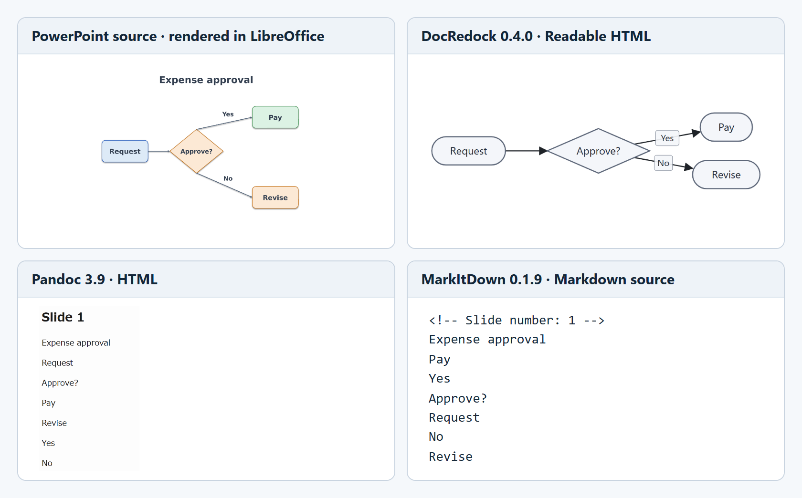

# DocRedock

<p align="center">
  <picture>
    <source media="(prefers-color-scheme: dark)" srcset="assets/brand/docredock/banners/dark/DocRedock-banner-dark-1200x400.png">
    <source media="(prefers-color-scheme: light)" srcset="assets/brand/docredock/banners/light/DocRedock-banner-light-1200x400.png">
    
  </picture>
</p>

DocRedockは、Word・Excel・PowerPoint・PDFをWindows・macOS・Linuxでローカル変換するツールです。表や画像、対応する図を**1つのHTMLファイルにまとめて共有**できます。AIで要約や分析をするときは、**MarkdownやAI向けパッケージ**で必要な内容を渡せます。

[English](README.md) · [v0.4.0 Public Betaをダウンロード](https://github.com/Takayuki-Ishimaru/docredock/releases/tag/v0.4.0) · [利用ガイド](docs/ja/user-guide.md)

## フローチャートの比較

[](assets/examples/flowchart/comparison.png)

DocRedockは、色や配置を変えてフローチャートをSVGで描き直します。矢印をたどると、原本と同じように **Yesは支払い、Noは差し戻し**に進みます。このサンプルでは、PandocのHTMLとMarkItDownのMarkdownはラベルを文字として出力します。

[サンプルのPowerPoint](assets/examples/flowchart/expense-approval.pptx) · [比較の再現手順（英語）](assets/examples/flowchart/README.md)

### 同じスライドのMarkdown出力

DocRedockは、矢印と **Yes**・**No** のラベルをMermaidで記述します。GitHubではそのまま図として表示されます。PandocとMarkItDownのMarkdownでは、ラベルが文字として並びます。[DocRedockのMarkdown](assets/examples/flowchart/docredock.md) · [PandocのMarkdown](assets/examples/flowchart/pandoc.md) · [MarkItDownのMarkdown](assets/examples/flowchart/markitdown.md)

## サンプルで試す

1. OSとCPUに合う配布ファイルをダウンロードします。展開し、DocRedockを起動します。[ダウンロードと起動の案内](release-docs/RELEASE_NOTES_v0.4.0.md#ダウンロードと更新)
2. [サンプルのPowerPoint](assets/examples/flowchart/expense-approval.pptx)をダウンロードして、アプリにドロップします。**閲覧用HTML**を選んで**書き出す**を押します。
3. **HTMLを開く**を押し、ブラウザーで **Yes** と **No** の矢印をたどります。

同じサンプルをMarkdownにするには、**閲覧用Markdown**を選んで書き出し、結果を開きます。手元の文書をAIに渡す場合は、共有前に変換結果、警告、添付画像を確認してください。Wordで削除した文字を出力から除外するには、変更履歴を**最終版のみ**にします。[内容ポリシーと変更履歴の設定](docs/ja/user-guide.md#4-内容ポリシーを選ぶ)

CLIをPATHに追加済みなら、HTMLとMarkdownをそれぞれ次のコマンドで書き出せます。

```sh
docredock export expense-approval.pptx --format html --ocr off -o expense-approval.html
docredock export expense-approval.pptx --format markdown --lang en --ocr off -o expense-approval.md
```

## 変換時間の比較

Windows 11の1台で比較したところ、DocRedockは大規模Excel（3シート、各20,000行）を **8.32秒でMarkdownに、9.04秒でHTMLに**変換しました。一方、大規模PowerPointのMarkdown変換ではPandocのほうが速い結果でした。

| 入力と出力 | DocRedock | MarkItDown | Mammoth | Pandoc | Docling |
| --- | ---: | ---: | ---: | ---: | ---: |
| 大規模Excel → Markdown | **8.32秒** | 40.63秒 | — | 15.33秒 | 44.27秒 |
| 大規模Excel → HTML | **9.04秒** | — | — | 24.18秒 | 37.37秒 |
| 大規模PowerPoint → Markdown | 3.97秒 | 3.37秒 | — | **2.12秒** | 13.60秒 |
| 小規模Word → Markdown | 1.70秒（OCRなしで0.66秒） | 2.03秒 | 0.45秒 | **0.13秒** | 8.97秒 |

ブラウザーで比較したところ、DocRedockでは列の多い表を狭い画面でも横にスクロールして読めました。Pandocでは比較した幅広の表の一部が1文字ずつ折り返されました。Mammothで変換したWordの表にはブラウザーの既定の書式が使われました。

表の値は、DocRedock 0.3.10をベースにHTML出力を組み込んだ開発ビルドで測りました。CLIの起動時間も含みます。上のフローチャートはv0.4.0の候補版で変換しました。`—`は計測の対象外です。[各ツールのバージョン・出力設定・測り方](release-docs/CONVERSION_REPORT_v0.4.0.md#比較の条件)

## v0.4.0 Public Betaの対応状況

v0.4.0では、閲覧用HTMLと、AIが原本の一部を確認できる機能を追加しました。Officeの図やPDFの表も読み取りやすくなりました。大きな文書をAIに渡すときは、必要な部分を選べます。[AI向けパッケージ](docs/ja/user-guide.md#ai向けパッケージ)

| 機能 | 扱い |
| --- | --- |
| AI向けパッケージ（フォルダー／ZIP） | GUI・CLI・APIで利用可。CLIのPDF入力は明示的な有効化が必要 |
| DOCX／XLSX／PPTX → 閲覧用Markdown | Public Betaとしてサポート |
| PDF → Markdown | デスクトップGUIではサポート。CLIは明示的な有効化が必要 |
| DOCX／XLSX／PPTX／PDF → 閲覧用HTML | GUI・CLI・MCPで利用可。CLI・MCPのPDF入力は明示的な有効化が必要 |
| Markdown編集 → Officeへ復元 | 実験機能・明示的な有効化が必要 |
| PDF／Officeの新規生成 | 実験機能・明示的な有効化が必要 |

形式ごとに変換できる内容と、このバージョンの変更点を確認できます。[対応状況](docs/ja/supported-features.md) · [v0.4.0リリースノート](release-docs/RELEASE_NOTES_v0.4.0.md)

## 閲覧用HTML

アプリで「閲覧用HTML」を選ぶか、CLIで `--format html` を指定します。対応する画像や図を1つのファイルにまとめ、ブラウザーでオフラインでも開けます。図の下の欄を展開すると、Mermaidのソースを確認できます。[閲覧用HTMLの利用ガイド](docs/ja/user-guide.md#閲覧用html)

```sh
docredock export report.xlsx --format html --content-policy visible
docredock export slides.pptx -o slides.html
```

## よくある3つの使い方

**1. 1つのファイルをAIに渡す**。Wordの変更履歴を除いた最終版を、画像の説明付きのMarkdownとして標準出力に書き出します。

```sh
docredock export 報告書.docx --revisions final -o -
```

**2. フォルダーを一括変換する**。同名のWord文書とPDFがある場合は、`--keep-source-extension` で `報告書.docx.md` と `報告書.pdf.md` に分けます。この例では `--allow-pdf` でPDFも変換します。

```sh
docredock export 資料フォルダー --output-dir 変換結果 --allow-pdf --keep-source-extension
```

**3. 大きな文書をAI向けパッケージにする**。章や表の行ごとに分割し、AIに渡す部分を選べます。

```sh
docredock export 予算.xlsx --ai-package dir --table-row-blocks
docredock package search 予算.ai-package 人件費
```

オプションの説明は`docredock help export`、確認が必要になったときの対処は[目的別ガイド](docs/ja/quick-tasks.md)を参照してください。

## 図の接続と代替表示

図形同士の接続を判断できる場合、DocRedockはMermaidで図を書き出します。接続を確定できない場合は、その理由を知らせ、取得できた文字やプレビュー画像を残します。

既定の `safe` は、確度の高い候補が1つに絞れたときだけ接続を推定します。原本に記録された接続だけを使う場合は `native-only`、推定候補を広げる場合は `balanced` を選びます。矛盾や重複などで確定できない接続は、未解決として報告します。CLIでは `docredock export input.pptx --visual-inference safe --output input.md` のように指定します。

正確なレイアウトや書式は原本で確認してください。SmartArtやWordの描画、PDFのベクター図は、一部だけ変換できる場合があります。PDFでは、ページのプレビュー画像や図の代わりとなる表示が入る場合もあります。警告が出たら、メッセージ、書き出された画像、原本を確認してください。

## 内容ポリシー

アプリとCLIでは、変換に含める内容を3種類のポリシーから選べます。Markdownの `.assets/` フォルダーには、出力したMarkdownから参照する画像だけが入ります。

| ポリシー | 動作 |
| --- | --- |
| `visible` | 既定値。認識できるOfficeの非表示テキスト、シート、行・列、スライド・オブジェクト、ノート、コメント、変更履歴のメタデータと、PDFで表示範囲の完全に外側にある文字や非表示レイヤーの文字を除外します。 |
| `complete` | 非表示情報とメタデータを含め、警告を出します。 |
| `sanitized` | `visible`に加え、メタデータ、派生・OCR情報、ヘッダー等をさらに除外します。 |

Wordの変更履歴は、`visible`／`complete`の既定では履歴付き表示（`markup`）となり、削除した文字を含む場合があります。`sanitized`の既定は、削除内容と履歴注記を除外する最終版（`final`）です。`--revisions final|markup|reject`で選択でき、`sanitized`の履歴付き出力には明示的な共有許可が必要です。履歴付きの出力は共有前に確認してください。

XLSX限定・CLI限定: `--sheets Sheet1,Sheet2`で指定したシートだけを書き出せます。指定した名前は既存のシート名と（大文字小文字を区別せず）完全一致する必要があります。存在しない名前を指定するとexit code 2で失敗し、出力ファイルは作成されません。一部の名前だけ一致しない場合（部分的な不一致）も、その名前を黙って無視せず失敗します。指定したシートが非表示で`visible`/`sanitized`ポリシーにより除外される場合はエラーにはなりませんが、`XlsxSheetExcludedByPolicy`という警告（exit code 1）を出し、出力が空に見える理由を説明します。含めるには`--content-policy complete`を使用してください。

## 主な制約

- v0.4.0はPublic Betaであり、本番向けの安定版ではありません。
- 閲覧用Markdownは一方向の出力です。元文書を正本として保持してください。
- 共有前にMarkdown、診断、assetを必ず確認し、部分的な図の投影を完全なものとして扱わないでください。
- CLIのPDF変換は`--allow-pdf`または`DOCREDOCK_ENABLE_EXPERIMENTAL=1`で有効にできます。往復／audit操作、復元、レンダリング／新規文書生成には引き続き`DOCREDOCK_ENABLE_EXPERIMENTAL=1`が必要です。読み取り専用の`docredock inspect <file.pdf>`は設定なしで利用できます。
- PDF OCRとvisual fallbackにはrasterizerとOCR providerの構成が必要な場合があります。利用できない場合はpage placeholderとWarningを確認してください。
- DocRedockは日本語PDFフォントを同梱・ダウンロードしません。フォントの導入・選択と埋め込みライセンスの確認は利用者の責任です。
- GUIは実行中バージョンを常時表示し、起動時または「更新を確認」からPublic Betaを含む非draftの公開版を確認できます。更新は自動インストールせず、`DOCREDOCK_DISABLE_UPDATE_CHECK=1`で起動時確認を無効化できます。
- 各配布物のSHA-256と署名／notarization状況を確認してください。

## ドキュメント

- [利用ガイド](docs/ja/user-guide.md)
- [v0.4.0の対応状況](docs/ja/supported-features.md)
- [セキュリティとプライバシー](docs/ja/security-and-privacy.md)
- [v0.4.0リリースノート](release-docs/RELEASE_NOTES_v0.4.0.md)
- [実験機能](docs/ja/experimental-features.md)
- [コントリビュート、ビルド、テスト](CONTRIBUTING.md)

## ライセンス

DocRedockは[MIT License](LICENSE)で公開されています。第三者依存関係と資産は[THIRD-PARTY-NOTICES.txt](THIRD-PARTY-NOTICES.txt)を参照してください。
