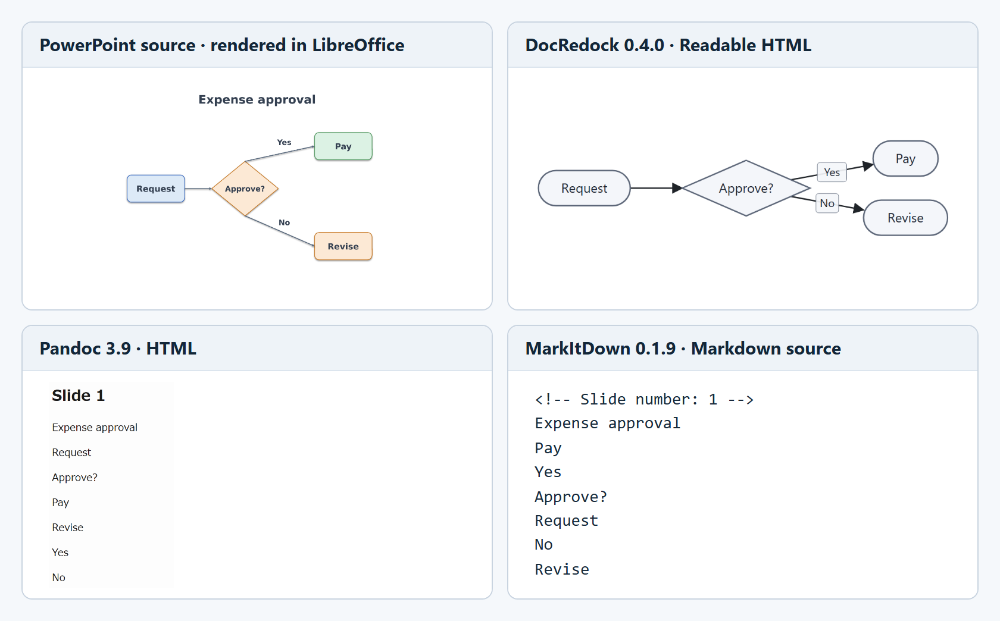

# DocRedock

<p align="center">
  <picture>
    <source media="(prefers-color-scheme: dark)" srcset="assets/brand/docredock/banners/dark/DocRedock-banner-dark-1200x400.png">
    <source media="(prefers-color-scheme: light)" srcset="assets/brand/docredock/banners/light/DocRedock-banner-light-1200x400.png">
    
  </picture>
</p>

DocRedock converts Word, Excel, PowerPoint, and PDF files locally on Windows, macOS, and Linux. Use **Readable HTML** to share tables, images, and supported diagrams in one file. Use **Markdown or an AI package** to give an AI assistant the document content it needs.

[日本語](README.ja.md) · [Download v0.4.1 Public Beta](https://github.com/Takayuki-Ishimaru/docredock/releases/tag/v0.4.1) · [User guide](docs/en/user-guide.md)

## Flowchart comparison

[](assets/examples/flowchart/comparison.png)

This v0.4.0 comparison shows how DocRedock redraws the flowchart in SVG with its own colors and layout. The arrows preserve the original decisions. **Yes leads to Pay, and No leads to Revise**. In this example, Pandoc’s HTML and MarkItDown’s Markdown show the labels as text.

[Sample PowerPoint](assets/examples/flowchart/expense-approval.pptx) · [How to reproduce the comparison](assets/examples/flowchart/README.md)

### Markdown output from the same slide

DocRedock’s Markdown contains a Mermaid block with the arrows and their **Yes** and **No** labels. GitHub renders the block as a diagram. In both other Markdown exports, the labels appear as text. [DocRedock Markdown](assets/examples/flowchart/docredock.md) · [Pandoc Markdown](assets/examples/flowchart/pandoc.md) · [MarkItDown Markdown](assets/examples/flowchart/markitdown.md)

## Try it with the sample

1. Download the archive for your operating system and CPU. Extract it and launch DocRedock. [Downloads and launch instructions](release-docs/RELEASE_NOTES_v0.4.1.en.md#downloads-and-upgrades)
2. Download the [sample PowerPoint](assets/examples/flowchart/expense-approval.pptx) and drop it into the app. Choose **Readable HTML** (「閲覧用HTML」), then select **Export** (「書き出す」).
3. Select **Open HTML** (「HTMLを開く」) and follow the **Yes** and **No** arrows in your browser.

To export the same sample as Markdown, choose **Readable Markdown** (「閲覧用Markdown」) and open the resulting file. When giving your own files to an AI assistant, review the output, warnings, and images before sharing. To exclude deleted text from Word, set Word revisions to **Final** (「最終版のみ」). [Content policies and revision settings](docs/en/user-guide.md#4-choose-a-content-policy)

With the CLI on your PATH, you can export either format.

```sh
docredock export expense-approval.pptx --format html --ocr off -o expense-approval.html
docredock export expense-approval.pptx --format markdown --lang en --ocr off -o expense-approval.md
```

## v0.4.1 Public Beta support

v0.4.1 improves Office layouts in Readable HTML, adds Excel review folders and portable Markdown, and updates AI integrations to allow direct inspection of originals. For large documents, use an [AI package](docs/en/user-guide.md#ai-packages) to select the parts to share.

| Feature | Status |
| --- | --- |
| AI packages (folder or ZIP) | GUI, CLI, and API. PDF input in the CLI requires explicit opt-in. |
| DOCX / XLSX / PPTX → Readable Markdown | Supported as Public Beta |
| PDF → Markdown | Desktop app. PDF input in the CLI requires explicit opt-in. |
| DOCX / XLSX / PPTX / PDF → Readable HTML | Desktop app, CLI, and MCP. PDF input in the CLI and MCP requires explicit opt-in. |
| Edited Markdown → Office restoration | Experimental. Requires explicit opt-in. |
| New PDF / Office document generation | Experimental. Requires explicit opt-in. |

See what each format supports and what changed in this version. [Supported features](docs/en/supported-features.md) · [v0.4.1 release notes](release-docs/RELEASE_NOTES_v0.4.1.en.md)

## Readable HTML

Select **Readable HTML** (「閲覧用HTML」) in the app or use `--format html` to export one file you can open offline in a browser. The file includes supported images and diagrams. Supported semantic diagrams also include their Mermaid source. [Readable HTML guide](docs/en/user-guide.md#readable-html)

```sh
docredock export report.xlsx --format html --content-policy visible
docredock export slides.pptx -o slides.html
```

## Visual meaning and fallback

DocRedock writes a diagram in Mermaid when it can determine how the shapes connect. If it cannot resolve the connections, it reports the issue and retains any available text or preview image.

The default mode, `safe`, infers a connection only when it finds one high-confidence match. Choose `native-only` to use only connections stored in the source, or `balanced` to consider a wider range of possible connections. DocRedock reports unresolved relationships, including conflicting or duplicate matches. To select a mode in the CLI, run `docredock export input.pptx --visual-inference safe --output input.md`.

Refer to the original for exact layout and styling. Conversion can preserve only part of SmartArt, Word drawings, or PDF vector diagrams. A PDF may use a page preview or placeholder. When you see a warning, review the message, any exported images, and the original.

## Content policy

Choose from three content policies when exporting in the desktop app or CLI. With Markdown, the `.assets/` folder contains only images referenced in the output.

| Policy | Behavior |
| --- | --- |
| `visible` | Default. Excludes recognized Office-hidden text, sheets, rows/columns, slides/objects, notes, comments, and revision metadata, and PDF text entirely outside the visible area or on a layer that is off. |
| `complete` | Includes hidden and metadata content and emits a warning. |
| `sanitized` | Applies the visible filter and additionally removes privacy-sensitive metadata, derived/OCR content, and document furniture. |

Word revisions use `markup` by default under `visible`/`complete` and may include deleted text. `sanitized` defaults to `final`, which excludes deletions and history annotations. Choose `--revisions final|markup|reject`; sanitized markup requires explicit sharing consent. Review revision markup before sharing.

XLSX-only, CLI-only: `--sheets Sheet1,Sheet2` exports only the named worksheets. Every requested name must exactly match an existing worksheet (case-insensitive); an unknown name fails the export with exit code 2 and writes no output file — a partial mismatch (some names found, some not) is never silently ignored. Requesting a hidden worksheet that the `visible`/`sanitized` policy excludes is not an error, but it emits an `XlsxSheetExcludedByPolicy` warning (exit code 1) instead of a silently empty-looking result; use `--content-policy complete` to include it.

## Important limitations

- v0.4.1 is a Public Beta, not a production-stable release.
- Readable Markdown is one-way output. Keep the original document as the authoritative source.
- Always review Markdown, diagnostics, and assets before sharing. Do not treat a partial visual projection as complete.
- Enable CLI PDF conversion with `--allow-pdf` or `DOCREDOCK_ENABLE_EXPERIMENTAL=1`. Round-trip/audit operations, restoration, and rendering/new-document generation still require `DOCREDOCK_ENABLE_EXPERIMENTAL=1`. Read-only `docredock inspect <file.pdf>` remains available without the flag.
- PDF OCR and visual fallback may require a configured rasterizer and OCR provider. If unavailable, review the page placeholder and warning.
- DocRedock does not bundle or download a Japanese PDF font. The user is responsible for selecting a font and complying with its embedding license.
- The GUI always shows the running version and checks published releases, including Public Beta builds, at startup or on demand. It never auto-installs an update; set `DOCREDOCK_DISABLE_UPDATE_CHECK=1` to disable startup checks.
- Verify the published SHA-256 checksum and signing/notarization status for each package.

## Documentation

- [Japanese user guide](docs/ja/user-guide.md)
- [English user guide](docs/en/user-guide.md)
- [v0.4.1 supported features](docs/en/supported-features.md)
- [Security and privacy](docs/en/security-and-privacy.md)
- [v0.4.1 release notes](release-docs/RELEASE_NOTES_v0.4.1.en.md)
- [Experimental features](docs/en/experimental-features.md)
- [Contributing, build, and test](CONTRIBUTING.md)

## License

DocRedock is released under the [MIT License](LICENSE). See [THIRD-PARTY-NOTICES.txt](THIRD-PARTY-NOTICES.txt) for third-party dependencies and assets.
