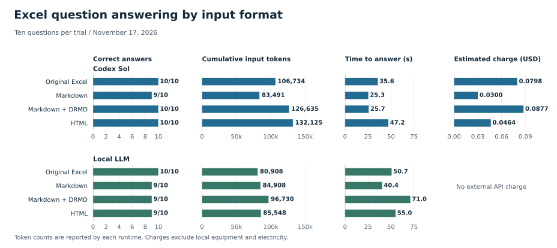
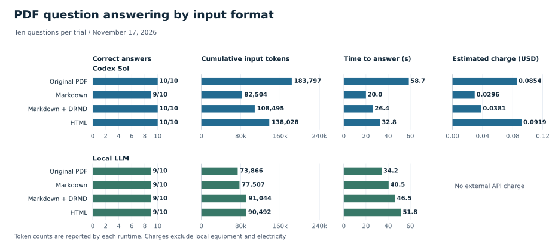
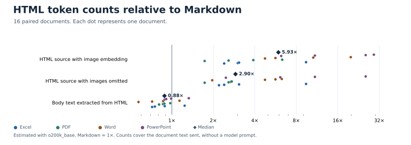

# How document format affects AI question answering

[日本語](CONVERSION_REPORT_v0.4.0.md) · [v0.4.0 release notes](RELEASE_NOTES_v0.4.0.en.md)

We compared original Excel and PDF files and their converted outputs using Codex Sol and a local LLM. The initial study used the same ten questions across four input formats per document and measured correctness, tokens, time to answer, and estimated token charges. The follow-up counted whole-document text inputs for 16 documents, including Word and PowerPoint files. It also repeated file-based trials on a different workbook and PDF.

## Conclusion

**Start with Markdown when you want an AI to read the text and table values of an Office document or PDF.** Markdown used fewer tokens than the full HTML source on all 16 documents in the follow-up, even when the HTML omitted images.

- **For a specific Excel cell or a few lines in a searchable PDF**, reading the relevant part of the original can be more efficient if the AI can retrieve it directly. In the follow-up, Codex used fewer tokens with the original sales workbook than with Markdown.
- **For photo colors, flowchart arrows, or page layout**, give the AI the relevant page or image. If the question needs both text and visual details, provide the Markdown along with the relevant image.
- **If you already have HTML**, extract the body text or the relevant table rows before passing them to the AI.

## Research question

How does converting an Excel workbook or PDF before giving it to an AI affect correctness, token use, time to answer, and estimated token charges? For each document and runtime, we used the original file as the baseline and asked the same questions about each of the three converted outputs. Because the formats preserve different information, we also examined answers by question type, separating text and table lookups from the question that depended on the photo.

## The workbook

The five worksheets represent cleanroom operations: a summary, 2,400 test runs, 720 equipment records, 430 incidents, and 390 shift logs. The 3,940 detail records are synthetic. The summary contains a native line chart and a photograph of a lighting test by NASA/Jack Pfaller. [Study workbook](https://github.com/Takayuki-Ishimaru/docredock/blob/v0.4.0/assets/examples/document-qa/cleanroom-operations.xlsx) · [Photo source](https://www.nasa.gov/image-article/very-illuminating/)

## What the RTMD exports contain

We converted the same workbook with the DocRedock v0.4.0 candidate, known as RTMD in this project. OCR was off for every conversion. The photo question therefore depended on whether the model could inspect the image.

| Input | Contents | File size in this study |
| --- | --- | ---: |
| Original Excel workbook (`.xlsx`) | Excel stores sheets, cells, charts, and pictures. In this trial, the reader retrieved native cell values and embedded images directly | 310,069 B |
| Readable Markdown (`.md`) | Projects sheet content as headings, text, and tables. For supported charts it can include source values as a table. Markdown can save image files separately by default. We selected `--images omit` and supplied only the Markdown | 347,918 B |
| Markdown and DRMD (`.md` + `.drmd`) | Supplies Markdown and an experimental round-trip companion file. This ZIP sidecar contains image files, the original workbook, and information used to map and restore the document | 366,734 B + 2,260,223 B |
| Readable HTML (`.html`) | Renders sheet content and tables as one browser-readable file. In this trial it embedded the photo in Base64 and exported the chart's values as a table | 889,376 B |

Save the study workbook as `study.xlsx` and export each format to a separate directory.

```sh
mkdir -p md drmd html
docredock export study.xlsx --format markdown --images omit --ocr off --title "Cleanroom operations" -o md/study.md
DOCREDOCK_ENABLE_EXPERIMENTAL=1 docredock export study.xlsx --profile roundtrip --sidecar zip --images omit --ocr off --title "Cleanroom operations" -o drmd/study.md
docredock export study.xlsx --format html --images embed --ocr off --title "Cleanroom operations" -o html/study.html
```

## Questions and scoring

Q01–Q08 ask about text or tables. Q09 can be answered from the chart's source values. Q10 asks about the photo. Each question was worth one point, and incorrect or unanswered (`null`) responses received zero. We scored the answers extracted from the JSON. Numbers had to match the expected integer. Text had to match after ignoring case and surrounding whitespace. The photo question accepted `yellow`, `gold`, or `golden`.

| Question | What we asked | Answer key |
| --- | --- | --- |
| Q01 | Review batch on Summary | `VOC-7264` |
| Q02 | Peak load for `RUN-1846` | 61 N |
| Q03 | Duration difference between `RUN-2381` and `RUN-0812` | 9 min |
| Q04 | Result for `RUN-2099` | `Passed` |
| Q05 | Calibration tag for `EQ-0542` | `CAL-2299` |
| Q06 | Downtime for `INC-0319` | 253 min |
| Q07 | Owner team for the equipment linked to `INC-0210` | `Vela` |
| Q08 | Total completed checks from `SHF-0301` through `SHF-0303` | 33 |
| Q09 | Month with the most verified runs in the chart | `May` |
| Q10 | Color of the folding barriers in front of the solar panels in the photo | Yellow |

## Method

On November 17, 2026, we ran one independent trial for each model and input format for both Excel and PDF, for sixteen trials in total. Both models received the same files, questions, and JSON answer format. We applied the same scoring rules.

- **Codex Sol.** We used Windows Codex CLI 0.164.0 with `gpt-6.1-sol` and reasoning effort set to `low`. It used the standard shell tools with user configuration disabled.
- **Local LLM.** We used the `fast` profile of a self-hosted service. All eight trials used the same inference backend and the standard Linux sandbox. Each trial reached the default step limit, and we scored the final answer it returned at that point.

Each trial received its assigned files and all ten questions at once. The instructions limited the evidence to the supplied files, prohibited network access and outside AI services, and requested `null` for any answer the model could not verify. Each model chose how to read the files using standard shell tools and available general-purpose libraries.

Each runtime reports its own token counts, including instructions and tool output sent again across model calls. Cached input is shown as `—` for local trials. Timing begins at CLI startup or local job start and ends when the final answer is available. It excludes conversion and queueing. Token counts and timing support comparisons between formats within each runtime.

### Cost calculation

We applied the published Codex Standard token rates checked on November 17, 2026. Per million tokens, the rates are USD 2.00 for uncached input, USD 0.10 for cached input, and USD 10.00 for output. We subtract cached tokens from cumulative input, apply each category's rate, and add the charges. Actual charges depend on the plan and its usage allowance. The self-hosted model incurred zero external API charges. We did not measure electricity and equipment costs. [OpenAI Codex Standard token rates](https://help.openai.com/en/articles/20001415-chatgpt-rate-card-enterprise-token-based-pricing)

## Excel results

| Model | Input | Correct | Cumulative input tokens | Of which cached | Output tokens | Total tokens | Time to answer (s) | Estimated token charge (USD) |
| --- | --- | ---: | ---: | ---: | ---: | ---: | ---: | ---: |
| Codex Sol | Excel (.xlsx) | 10/10 | 106,734 | 73,344 | 567 | 107,301 | 35.6 | 0.0798 |
| Codex Sol | Markdown (.md) | 9/10 | 83,491 | 73,856 | 332 | 83,823 | 25.3 | 0.0300 |
| Codex Sol | Markdown + DRMD | 10/10 | 126,635 | 89,344 | 423 | 127,058 | 25.7 | 0.0877 |
| Codex Sol | HTML (.html) | 10/10 | 132,125 | 120,192 | 1,052 | 133,177 | 47.2 | 0.0464 |
| Local LLM | Excel (.xlsx) | 10/10 | 80,908 | — | 1,966 | 82,874 | 50.7 | 0.0000 |
| Local LLM | Markdown (.md) | 9/10 | 84,908 | — | 858 | 85,766 | 40.4 | 0.0000 |
| Local LLM | Markdown + DRMD | 9/10 | 96,730 | — | 1,027 | 97,757 | 71.0 | 0.0000 |
| Local LLM | HTML (.html) | 9/10 | 85,548 | — | 2,202 | 87,750 | 55.0 | 0.0000 |



With Codex, Markdown answered all nine questions on text, tables, and chart values and left the photo question blank. Of the fully correct runs, Markdown with DRMD was fastest and HTML had the lowest estimated charge.

The local LLM answered those same nine questions with Markdown in 40.4 seconds, down from 50.7 seconds with the original workbook. Markdown used 4.9% more cumulative input tokens. The original workbook was the only format that yielded the correct color. The Markdown with DRMD and HTML trials also left that question blank.

### Relation to the earlier Excel experiment

In August 2026, we let the agent choose how and where to read and observed 74.1% fewer cumulative input tokens with Markdown than with direct Excel access. In the current study, Markdown reduced Codex input by 21.8% and increased the local LLM's input by 4.9% on the same document and questions. Cumulative input depends on the format, the reading steps, and how much text those steps send back to the model. [Earlier Excel experiment](https://github.com/Takayuki-Ishimaru/docredock/blob/v0.4.0/docs/AI_DOCUMENT_FORMAT_TOKEN_BENCHMARK_2026-08-25.md)

## PDF experiment

We created a **96-page PDF with 3,008 records** for a synthetic thermal qualification study. Page 1 has a monthly line chart and its source table. Pages 2–95 contain test records and page 96 contains a photograph. The records are fictional. NASA/Jack Pfaller took the photograph. [Study PDF](https://github.com/Takayuki-Ishimaru/docredock/blob/v0.4.0/assets/examples/document-qa/thermal-qualification-field-report.pdf) · [Photo source](https://www.nasa.gov/image-article/very-illuminating/)

### Inputs and method

We followed the same procedure as for Excel, with one trial per model for the original PDF and each of the three conversions. For the original PDF, each model chose how to inspect the page text and embedded images.

| Input | File size in this study | What it contains |
| --- | ---: | --- |
| Original PDF (`.pdf`) | 484,145 B | Pages, tables, a chart, and a photo in the original layout |
| Readable Markdown (`.md`) | 206,242 B | Projected text and tables, with the image bytes omitted |
| Markdown and DRMD (`.md` + `.drmd`) | 278,835 B + 757,354 B | Text plus a sidecar containing the photo, original PDF, and restoration data |
| Readable HTML (`.html`) | 825,688 B | Text and tables in HTML with the supported photo embedded as Base64 |

We disabled OCR and fallback page images for every conversion. Save the source as `study.pdf` and export each format to a separate directory.

```sh
mkdir -p md drmd html
docredock export study.pdf --allow-pdf --ocr off --pdf-fallback-images off --title "Thermal qualification field report" --format markdown --images omit -o md/study.md
DOCREDOCK_ENABLE_EXPERIMENTAL=1 docredock export study.pdf --allow-pdf --ocr off --pdf-fallback-images off --title "Thermal qualification field report" --profile roundtrip --sidecar zip --images omit -o drmd/study.md
docredock export study.pdf --allow-pdf --ocr off --pdf-fallback-images off --title "Thermal qualification field report" --format html --images embed -o html/study.html
```

### Ten questions about the PDF

We used the same one-point scoring as for Excel. Q09 can be answered from the chart data, and Q10 requires inspecting the photo.

| Question | What we asked | Answer key |
| --- | --- | --- |
| Q01 | Review batch code in the overview | `THM-5938` |
| Q02 | Leak rate for `T-0187` | 63 Pa/h |
| Q03 | Cycle duration difference between `T-2456` and `T-0612` | 35 min |
| Q04 | Disposition for `T-1122` | `Recheck` |
| Q05 | Calibration tag for `T-1665` | `CT-5841` |
| Q06 | Downtime for `T-2710` | 184 min |
| Q07 | Owner team for `T-2033` | `Aquila` |
| Q08 | Total completed checks for `T-2841` through `T-2843` | 42 |
| Q09 | Month with the most verified cycles | `Jun` |
| Q10 | Color of the folding barriers in front of the solar panels | `yellow` |

### PDF results

| Model | Input | Correct | Cumulative input tokens | Of which cached | Output tokens | Total tokens | Time to answer (s) | Estimated token charge (USD) |
| --- | --- | ---: | ---: | ---: | ---: | ---: | ---: | ---: |
| Codex Sol | PDF (.pdf) | 10/10 | 183,797 | 151,936 | 645 | 184,442 | 58.7 | 0.0854 |
| Codex Sol | Markdown (.md) | 9/10 | 82,504 | 72,960 | 317 | 82,821 | 20.0 | 0.0296 |
| Codex Sol | Markdown + DRMD | 10/10 | 108,495 | 96,640 | 469 | 108,964 | 26.4 | 0.0381 |
| Codex Sol | HTML (.html) | 10/10 | 138,028 | 99,840 | 551 | 138,579 | 32.8 | 0.0919 |
| Local LLM | PDF (.pdf) | 9/10 | 73,866 | — | 890 | 74,756 | 34.2 | 0.0000 |
| Local LLM | Markdown (.md) | 9/10 | 77,507 | — | 1,415 | 78,922 | 40.5 | 0.0000 |
| Local LLM | Markdown + DRMD | 9/10 | 91,044 | — | 1,056 | 92,100 | 46.5 | 0.0000 |
| Local LLM | HTML (.html) | 9/10 | 90,492 | — | 2,129 | 92,621 | 51.8 | 0.0000 |



With Codex, Markdown answered all nine non-photo questions correctly. Markdown with DRMD got all ten right in 26.4 seconds at an estimated USD 0.0381. The original PDF took 58.7 seconds at an estimated USD 0.0854.

The local LLM got all nine non-photo questions right in all four formats. The original was fastest at 34.2 seconds and used the fewest cumulative input tokens. Markdown took 40.5 seconds and used 4.9% more cumulative input tokens than the original. The model answered “orange” for the original PDF and left the photo question blank in all three converted formats.

## Discussion

All 16 trials answered Q01–Q09 correctly. The difference in total scores came from Q10, the photo question. Because Q09 can be answered from the data behind the chart, this question measures retrieval of the values. Assessing how well models interpret a chart's appearance, or handle harder questions in other documents, would require tasks designed for those purposes.

### Why Markdown used fewer input tokens with Codex

For Markdown, Codex searched for the IDs and column names in the questions and read mainly the matching rows and headers. With the original PDF, the first library it tried was unavailable. It used another library to print text from all 96 pages, then narrowed its search to the relevant pages. Markdown made it easier to look up individual rows, which likely reduced the amount of text returned to the model during the search. The Excel export paired with DRMD also contained comments that identify editable content, so the reading command returned more text than it did for the readable Markdown export.

### Why time and token counts differed with the local LLM

For the original workbook, the local LLM filtered rows by their IDs and extracted the photo to examine its pixels. For Markdown, it also read the first 80 lines and the start of several sections and ran commands to look for the image. Reading those extra lines and carrying tool output forward across model calls may explain the increase in cumulative input. The elapsed time for the original workbook includes extracting and examining the photo.

For the original PDF, the local LLM used `pdftotext -layout` to produce a text file that preserved the table columns, then searched for matching IDs. Some commands searching the Markdown for headings or the photo stopped early, so the model tried additional searches and line ranges. The PDF already had a searchable text layer, which appears to have made the original easier to query in this trial.

### Why retaining a photo still leaves a visual task

The local LLM had the same photo in both originals. For Excel it compared counts of yellow and orange pixels and got the answer right. For PDF it sampled colors in a cropped region and answered orange. The local LLM also extracted the photo from the Excel HTML and the PDF DRMD, then returned `null` for the color. These runs suggest that locating the object and examining its color after extraction can affect the result. Codex's execution records document image extraction or decoding. Its 10/10 scores reflect the answers it returned.

Both HTML exports store the photo as 165,180 Base64 characters. Extracting just the headings and tables makes HTML usable for the same text questions as Markdown. Pasting the full HTML source also sends the encoded image as text. When the question depends on the photo, giving the original file or the relevant image to a model with image support may be simpler. In this study, the models chose how to read the supplied files. Pasting the full source or sending every page as an image would change how much information reaches the model.

### Why more cumulative input sometimes cost less

For Codex's Excel trial, 91.0% of HTML's 132,125 input tokens were cached, leaving 11,933 uncached tokens. The original workbook had 33,390 uncached input tokens. The lower rate for cached input gave HTML the lowest estimated charge of the three fully correct formats. With the PDF, HTML used more uncached input tokens than the original, and its estimated charge was also higher.

### Study limitations

We ran one trial per condition with one workbook, one PDF, and the same photo in both documents. Estimating trial-to-trial variation or testing whether the results hold on other documents and photos would require more examples and repeated trials. The PDF had selectable text, so scanned-document OCR falls outside the study's scope.

The measurements reflect file format, available tools, the reading steps each model chose, and cache usage. For example, the Markdown-only export omitted the image because of the selected export setting. A comparison that isolates the effect of file format would also hold the scope of each search and the way images are presented constant.

## Follow-up on when Markdown and HTML help

### Sending the same 16 documents as text

We selected four files each for Excel, PDF, Word, and PowerPoint, covering different combinations of prose, tables, and figures. With the DocRedock v0.4.0 candidate, we exported Markdown with images omitted and HTML both with and without image embedding. OCR was off. For PDF, fallback page images were off as well. We compared the full Markdown text with the full HTML source and with text extracted from HTML headings, paragraphs, and tables. The extraction skipped styles, scripts, and navigation and used tabs to separate cells.

The table and chart use `tiktoken` 0.14.0 with `o200k_base`. We normalized line endings to LF and counted the document text alone. Questions, system instructions, and tokens for images sent as images are outside these counts. Each ratio uses the Markdown count for that document as its baseline. The table shows the median and range across the 16 documents.

| Text sent to the model | Median relative to Markdown | Range | Documents below Markdown |
| --- | ---: | ---: | ---: |
| Full HTML source with image embedding | 5.93× | 1.73–29.23× | 0/16 |
| Full HTML source with images omitted | 2.90× | 1.73–25.48× | 0/16 |
| Body and table text extracted from HTML | 0.88× | 0.57–1.33× | 13/16 |



With `cl100k_base`, full HTML source also used more tokens than Markdown on all 16 documents both with and without images. The extracted body and table text used fewer tokens on 12 documents. For four Excel and PDF files, we kept only lines that matched the same five search terms per document. The Markdown excerpts used 118–313 tokens and the HTML text excerpts used 92–267. These counts measure excerpt size. How much table and figure structure survives depends on how the text is extracted. [Document list and measurements (CSV)](CONVERSION_REPORT_v0.4.0-inputs.csv)

Seven documents contained Base64 images in their HTML. Removing just the encoded image data from those same files saved 53–112,519 tokens, with a median of 107,829. Sending the encoded data alongside the body text can substantially increase the size of a text query. For a question that depends on a photo or diagram, the relevant image can also be sent to a model with image support. The 16-document token comparison covers text inputs. It leaves the cost and accuracy of direct image input unmeasured.

### Giving the model a file to search

We used an Excel sales workbook and a PDF specification with a text layer, both different from the initial study. For each document we asked the same five questions about the original, Markdown, and HTML. They covered values in text and tables and simple calculations. The analysis includes two trials per condition for both Codex Sol and the local LLM, for a total of 24. We used the same shuffled schedule for both runtimes. Each trial started a fresh session and asked the model to inspect the assigned file with standard tools. We replaced trials that accessed files outside the assigned inputs. The HTML exports used the image embedding setting and contained zero Base64 images.

All 24 trials answered all five questions correctly. The table reports the minimum and maximum of two trials. We measured time and estimated charges as in the initial study. The local LLM incurred zero external API charges.

| Runtime | Document | Input | Cumulative input tokens | Time to answer (s) | Estimated token charge (USD) |
| --- | --- | --- | ---: | ---: | ---: |
| Codex Sol | Sales workbook (Excel) | Original | 52,852–59,451 | 15.1–19.4 | 0.0183–0.0229 |
| Codex Sol | Sales workbook (Excel) | Markdown | 70,834–81,028 | 17.9–18.5 | 0.0203–0.0401 |
| Codex Sol | Sales workbook (Excel) | HTML | 55,649–61,739 | 13.2–14.1 | 0.0232–0.0269 |
| Codex Sol | Specification (PDF) | Original | 81,377–81,960 | 18.8–22.5 | 0.0288–0.0303 |
| Codex Sol | Specification (PDF) | Markdown | 55,402–61,489 | 12.7–14.2 | 0.0389–0.0556 |
| Codex Sol | Specification (PDF) | HTML | 64,572–64,637 | 13.6–13.8 | 0.0452–0.0559 |
| Local LLM | Sales workbook (Excel) | Original | 34,821–44,243 | 26.6–31.8 | 0.0000 |
| Local LLM | Sales workbook (Excel) | Markdown | 40,802–57,212 | 32.3–34.6 | 0.0000 |
| Local LLM | Sales workbook (Excel) | HTML | 50,314–71,939 | 37.8–42.0 | 0.0000 |
| Local LLM | Specification (PDF) | Original | 67,084–77,751 | 36.2–38.6 | 0.0000 |
| Local LLM | Specification (PDF) | Markdown | 88,295–89,430 | 27.6–28.5 | 0.0000 |
| Local LLM | Specification (PDF) | HTML | 74,587–88,506 | 36.7–41.1 | 0.0000 |

Codex retrieved mainly the matching rows and headers from the original workbook and used fewer input tokens than with Markdown. It printed text from every page of the original PDF, and both Markdown and HTML used fewer cumulative input tokens. With the local LLM, Markdown from the PDF gave faster answers and used more cumulative input tokens than the original. With Codex, both PDF conversions gave faster answers and higher estimated charges. When an AI receives a file, the result depends on which parts it reads, how much information its tools return, and how much input is cached.

The 16-document results apply to sending **whole documents as text** under the export settings used here. The file-based follow-up repeated trials on one additional workbook and one additional PDF. Word and PowerPoint were part of the text-token comparison. We deliberately chose files with different structures, so the sample cannot establish how common these results are across workplace documents.

## A document conversion case study

In an earlier test, we measured file conversion time and compared how the converted files looked in a browser.

### Benchmark Conditions

- Environment: Windows 11, Intel Core i9-12950HX, 24 GB memory.
- Build under test: DocRedock 0.3.10 development build (pre-release, including the HTML-output changes). Compared tools: MarkItDown 0.1.9, Mammoth 1.13.0, Pandoc 3.14, Docling 2.150.0 (running on the CPU build of torch).
- Method: for each combination, one initial run was excluded and the median of three warm runs was taken; Docling used a single warm run. Times are measured at the CLI and include process start.
- Documents: small documents, most a few KB, plus synthetic medium and large documents. Large: DOCX and PPTX with 300 sections; XLSX with 3 sheets x 20,000 rows x 12 columns.
- Combinations outside a tool's support are marked n/a. They are not failures: Pandoc cannot read PDF, Mammoth handles DOCX only, and MarkItDown outputs Markdown only.
- DocRedock's default OCR (`auto`) runs on DOCX and PPTX files that contain images. OCR settings differ by tool, so `--ocr off` results are listed alongside.
- For HTML, DocRedock used `--format html`, Pandoc used `--standalone --embed-resources`, and Docling used `--image-export-mode embedded`. For Markdown, DocRedock used its defaults, Pandoc used `-t gfm --wrap=none --extract-media`, Docling used `--image-export-mode referenced`, and Mammoth used `--output-format=markdown`.

### Small documents (Markdown output, seconds)

For small documents, process startup can account for much of the elapsed time. The table shows the median of the per-document medians for successful conversions. The set of successful documents can vary by tool.

| Format | DocRedock | DocRedock (no OCR) | MarkItDown | Mammoth | Pandoc | Docling |
| --- | --- | --- | --- | --- | --- | --- |
| DOCX | 1.70 | 0.66 | 2.03 | 0.45 | 0.13 | 8.97 |
| PPTX | 0.84 | 0.85 | 1.83 | n/a | 0.11 | 9.01 |
| XLSX | 0.61 | 0.58 | 1.82 | n/a | 0.06 | 8.83 |
| PDF | 1.00 | 1.01 | 1.78 | n/a | n/a | 20.04 |

HTML output on the real files took about the same time as Markdown: DocRedock's DOCX was 1.66 s (0.65 s with OCR off) and PPTX was 0.87 s.

### Large-Document Speed (seconds)

Markdown output:

| Document | DocRedock | DocRedock (no OCR) | MarkItDown | Mammoth | Pandoc | Docling |
| --- | --- | --- | --- | --- | --- | --- |
| large.docx | 2.51 | 2.39 | 8.23 | 3.55 | 1.72 | 18.11 |
| large.pptx | 3.97 | 4.18 | 3.37 | n/a | 2.12 | 13.60 |
| large.xlsx | 8.32 | 8.46 | 40.63 | n/a | 15.33 | 44.27 |

large.xlsx written as HTML (Mammoth cannot read XLSX and MarkItDown cannot emit HTML, hence n/a):

| Tool | Markdown | HTML |
| --- | --- | --- |
| DocRedock | 8.32 | 9.04 |
| Pandoc | 15.33 | 24.18 |
| Docling | 44.27 | 37.37 |

### What the HTML looked like

We opened the sample conversions side by side in a browser, including Word, PowerPoint, Excel, and PDF. We also checked light and dark themes, print styling, and a narrow viewport on selected files.

- **Wide tables:** DocRedock used borders, alternating row backgrounds, and right-aligned numeric columns. On a narrow screen, wide tables scrolled sideways. Pandoc’s output wrapped some cells one character at a time in the wide table we compared. Mammoth’s Word output used browser defaults for table styling.
- **Diagrams and charts.** Some outputs redrew connections between shapes as SVG. Others kept the shape labels in the text. One output represented the underlying chart values as a table. Which output is usable depends on whether the task requires arrows, chart appearance, or just text and values.
- **Differences from the original:** In the Word sample, a note that spanned the last row appeared below the table as a paragraph. Excel merged-cell boundaries are not recreated in HTML. Check the original for exact appearance, layout, and diagram relationships.

These observations apply to the files and export settings compared here.

We converted the expense approval sample separately with the DocRedock v0.4.0 candidate, Pandoc 3.9, and MarkItDown 0.1.9. All three ran on the same PowerPoint file so you can compare which connections and labels remain. [Original slide and actual exports](https://github.com/Takayuki-Ishimaru/docredock/blob/v0.4.0/README.md#flowchart-comparison)

### Limitations of the comparison

- The tests ran on one machine. Small differences should not be used to rank tools, and separate CLI runs do not predict the speed of batches or a persistent process.
- Docling reads PDF with machine-learning models and was measured with models already downloaded; first-run download time is not included.
