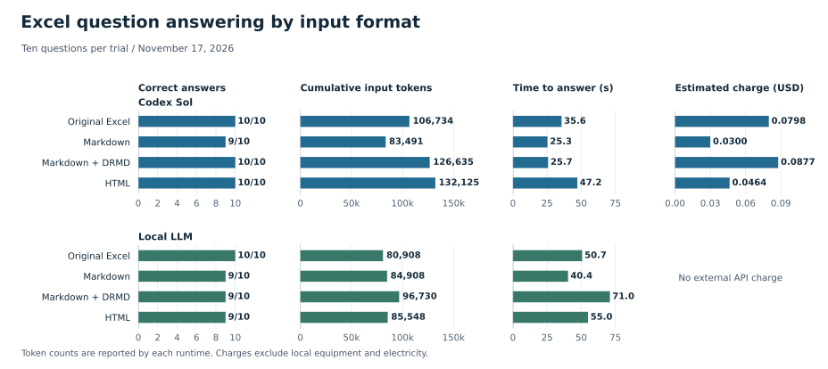
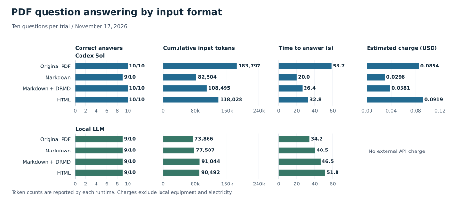
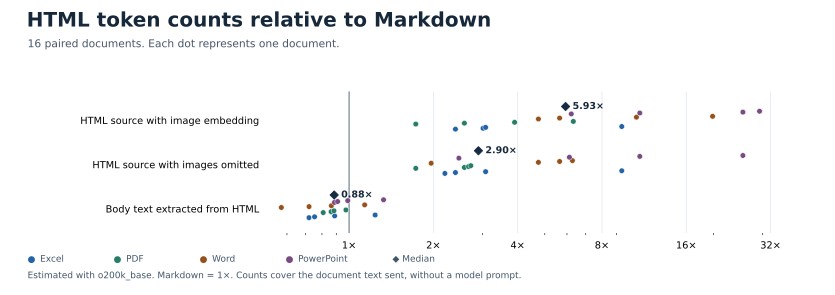

# 文書の形式でAIの質問応答はどう変わるか

[English](CONVERSION_REPORT_v0.4.0.en.md) · [v0.4.0リリースノート](RELEASE_NOTES_v0.4.0.md)

Excel・PDFの原本と変換出力をCodex SolとローカルLLMで比較しました。初回は各文書で4形式に同じ10問を出し、正答数、トークン、回答までの時間、推定従量料金を測りました。追試ではWordとPowerPointを含む16文書で全文入力時のトークン数を比較し、別のExcelとPDFでファイルを渡した場合も反復測定しました。

## 結論

**Office文書やPDFの本文・表の数値をAIにまとめて読ませるなら、まずMarkdownに変換します。** 追試では、画像を省いたHTMLソース全文と比べても、16文書すべてでMarkdownの方が少ないトークンで済みました。

- **Excelの特定セルや、検索できるPDFの数行だけを調べる場合**は、AIが原本から該当箇所を直接取り出せるなら、その方が効率的なことがあります。追試では、Codexは売上表の原本を読む方がMarkdownより少ないトークンで済みました。
- **写真の色、フローチャートの矢印、ページの配置を確認する場合**は、原本の該当ページや画像を渡します。本文と見た目の両方が必要なら、Markdownに該当画像を添えます。
- **手元のHTMLを使う場合**は、本文や必要な表の行を抽出してAIに渡します。

## 調査の目的

ExcelやPDFを変換してAIに渡すと、正答数、トークン消費、回答時間、推定従量料金はどう変わるかを調べました。各文書・実行環境で原本を基準とし、同じ設問で3種類の変換出力と比較しました。本文や表から答えを探す場合と、写真の情報が必要な場合では、変換後に参照できる情報が異なるため、回答を設問の種類ごとにも確認しました。

## 試験に使ったExcel

クリーンルームの試験記録を想定し、概要、試験実績2,400件、設備台帳720件、障害430件、引き継ぎ390件の5シートを用意しました。明細は計3,940件です。概要シートには月別の折れ線グラフと、照明試験を写した写真1枚があります。運用データは架空で、写真はNASA/Jack Pfallerによるものです。[実験用Excel](https://github.com/Takayuki-Ishimaru/docredock/blob/v0.4.0/assets/examples/document-qa/cleanroom-operations.xlsx) · [写真の出典](https://www.nasa.gov/image-article/very-illuminating/)

## RTMDが生成する形式

RTMD（公開名はDocRedock）のv0.4.0候補版で同じExcelを変換しました。変換時のOCRは全条件でオフにしました。したがって写真だけに写った情報は、画像を参照できる場合にだけ確認できます。

| 入力 | 内容 | 今回のファイルサイズ |
| --- | --- | ---: |
| Excel原本（`.xlsx`） | シート、セル、グラフ、写真をExcelの形式で保持。試験では原本のセルと埋め込み画像を直接読み取った | 310,069 B |
| 閲覧用Markdown（`.md`） | シートの内容を見出し、テキスト、表に変換。対応するグラフは元データを表にできる。既定では画像は別ファイルに保存でき、今回は `--images omit` でMarkdownだけを渡した | 347,918 B |
| Markdown＋DRMD（`.md`＋`.drmd`） | 本文に加え、実験機能の往復編集用サイドカーを渡した。今回のZIP形式のサイドカーには、画像、原本のExcel、対応関係や復元用の情報が入る | 366,734 B＋2,260,223 B |
| 閲覧用HTML（`.html`） | シートや表をブラウザーで開ける1ファイルに変換。今回は対応する写真をBase64で埋め込み、グラフの数値は表として出力した | 889,376 B |

実験用Excelを `study.xlsx` として置き、3種類の変換結果を別々のフォルダーに書き出します。

```sh
mkdir -p md drmd html
docredock export study.xlsx --format markdown --images omit --ocr off --title "Cleanroom operations" -o md/study.md
DOCREDOCK_ENABLE_EXPERIMENTAL=1 docredock export study.xlsx --profile roundtrip --sidecar zip --images omit --ocr off --title "Cleanroom operations" -o drmd/study.md
docredock export study.xlsx --format html --images embed --ocr off --title "Cleanroom operations" -o html/study.html
```

## 質問と採点

Q01〜Q08は本文・表の照会、Q09はグラフの元データでも解ける設問、Q10は写真の色を読む設問です。各問を1点とし、誤答と `null`（未回答）は0点としました。返されたJSONから回答を取り出し、数値は整数値の一致、文字列は前後の空白と大文字・小文字の違いを除いた一致で判定しました。写真の「黄色」には `yellow`、`gold`、`golden` を認めました。

| 問 | 確認した内容 | 正解 |
| --- | --- | --- |
| Q01 | SummaryのReview batch | `VOC-7264` |
| Q02 | `RUN-1846` のピーク荷重 | 61 N |
| Q03 | `RUN-2381` と `RUN-0812` の所要時間の差 | 9分 |
| Q04 | `RUN-2099` の結果 | `Passed` |
| Q05 | `EQ-0542` の校正タグ | `CAL-2299` |
| Q06 | `INC-0319` の停止時間 | 253分 |
| Q07 | `INC-0210` に紐づく設備の管理チーム | `Vela` |
| Q08 | `SHF-0301` から `SHF-0303` までの完了点検数の合計 | 33件 |
| Q09 | 月別グラフで検証済み試験数が最大の月 | `May` |
| Q10 | 写真のソーラーパネル手前にある伸縮式バリケードの色 | 黄色 |

## 測定方法

2026年11月17日、ExcelとPDFそれぞれの4形式をCodex SolとローカルLLMで1回ずつ、計16回、独立したセッションで測りました。両モデルに同じ入力ファイル、設問、JSON回答形式を与え、同じ基準で採点しました。

- **Codex Sol**。Windows版Codex CLI 0.164.0で `gpt-6.1-sol` を使用し、推論設定を `low` に固定しました。ユーザー設定を読み込まず、標準のシェルツールを使いました。
- **ローカルLLM**。自己ホスト環境の `fast` プロファイルを使用しました。8試行で同じ推論エンジンと標準のLinuxサンドボックスを使いました。8試行とも既定のステップ上限に達し、その時点で返された最終回答を採点しました。

各セッションには、その条件のファイルと10問をまとめて渡しました。指定したファイルだけを根拠とし、ネットワークや別のAIサービスを使わず、確認できない答えには `null` を返すよう指示しました。ファイルの読み方は各モデルに任せ、利用できる標準のシェルや汎用ライブラリで調べました。

入力トークンは各実行環境の報告値で、指示やツール出力の再入力分を含みます。ローカル試行のキャッシュ済み入力は表で `—` と示します。時間はCodex CLIの起動またはローカルジョブの実行開始から最終回答を取得するまでで、事前変換と待ち行列を除きます。トークン数と時間は、各実行環境の中で形式を比較するための値です。

### 料金の計算

Codexの料金は2026年11月17日に確認した公開標準従量単価で換算しています。100万トークンあたり、未キャッシュ入力は2.00米ドル、キャッシュ済み入力は0.10米ドル、出力は10.00米ドルです。累積入力からキャッシュ済み分を差し引き、それぞれに単価を掛けて合計しました。実際の請求額は契約や利用枠によって変わります。今回のローカルLLMに外部APIの従量料金はかかりません。電力費と機材費は計測していません。[OpenAIのCodex標準従量単価](https://help.openai.com/en/articles/20001415-chatgpt-rate-card-enterprise-token-based-pricing)

## Excelの実測結果

| モデル | 入力 | 正答 | 累積入力トークン | うちキャッシュ済み | 出力トークン | 合計トークン | 回答まで（秒） | 推定従量料金（USD） |
| --- | --- | ---: | ---: | ---: | ---: | ---: | ---: | ---: |
| Codex Sol | Excel (.xlsx) | 10/10 | 106,734 | 73,344 | 567 | 107,301 | 35.6 | 0.0798 |
| Codex Sol | Markdown (.md) | 9/10 | 83,491 | 73,856 | 332 | 83,823 | 25.3 | 0.0300 |
| Codex Sol | Markdown + DRMD | 10/10 | 126,635 | 89,344 | 423 | 127,058 | 25.7 | 0.0877 |
| Codex Sol | HTML (.html) | 10/10 | 132,125 | 120,192 | 1,052 | 133,177 | 47.2 | 0.0464 |
| ローカルLLM | Excel (.xlsx) | 10/10 | 80,908 | — | 1,966 | 82,874 | 50.7 | 0.0000 |
| ローカルLLM | Markdown (.md) | 9/10 | 84,908 | — | 858 | 85,766 | 40.4 | 0.0000 |
| ローカルLLM | Markdown + DRMD | 9/10 | 96,730 | — | 1,027 | 97,757 | 71.0 | 0.0000 |
| ローカルLLM | HTML (.html) | 9/10 | 85,548 | — | 2,202 | 87,750 | 55.0 | 0.0000 |



Codexでは、Markdownが本文・表・グラフの数値の9問に正答し、写真の設問は未回答でした。全問正答した条件ではMarkdown＋DRMDが最速で、HTMLの推定料金が最少でした。

ローカルLLMでは、Markdownは同じ9問に正答し、原本の50.7秒から40.4秒に短縮しました。累積入力トークンは原本より4.9%増えました。写真の色に正答したのは原本だけで、Markdown＋DRMDとHTMLでも写真の設問は未回答でした。

### 以前のExcel検証との関係

2026年8月の検証では、AIが読み方と範囲を選ぶ条件で、Markdownの累積入力はExcel原本より74.1%少なくなりました。今回もCodexでは21.8%減り、同じ文書と設問を使ったローカルLLMでは4.9%増えました。最終的な入力トークン数には、文書形式に加え、ツールで何を読み、どれだけのテキストをモデルに返すかが影響します。[以前のExcel検証](https://github.com/Takayuki-Ishimaru/docredock/blob/v0.4.0/docs/AI_DOCUMENT_FORMAT_TOKEN_BENCHMARK_2026-08-25.md)

## PDFの追加実験

熱試験の記録を想定した**96ページ、3,008件**のPDFを新規作成しました。1ページ目に月別の折れ線グラフと元データの表、2〜95ページに試験明細、96ページ目に写真があります。明細は架空で、写真はNASA/Jack Pfallerによるものです。[検証用PDF](https://github.com/Takayuki-Ishimaru/docredock/blob/v0.4.0/assets/examples/document-qa/thermal-qualification-field-report.pdf) · [写真の出典](https://www.nasa.gov/image-article/very-illuminating/)

### 入力の準備と測定方法

Excelと同じ測定手順を使い、両モデルでPDF原本と3種類の変換出力を各1回試しました。原本を渡した試行では、ページの文字や埋め込み画像を調べる手順を各モデルが選びました。

| 入力 | 今回のファイルサイズ | 変換時の扱い |
| --- | ---: | --- |
| PDF原本（`.pdf`） | 484,145 B | ページ、表、グラフ、写真をそのまま保持 |
| 閲覧用Markdown（`.md`） | 206,242 B | 文字と表を変換し、写真の実データは省略 |
| Markdown＋DRMD（`.md`＋`.drmd`） | 278,835 B＋757,354 B | 本文と、写真・PDF原本・復元用の情報を入れたサイドカー |
| 閲覧用HTML（`.html`） | 825,688 B | 文字と表をHTMLにし、対応する写真をBase64で埋め込み |

すべての変換でOCRと原本照合用のページ画像生成をオフにしました。PDFを `study.pdf` として置き、各結果を別フォルダーへ書き出します。

```sh
mkdir -p md drmd html
docredock export study.pdf --allow-pdf --ocr off --pdf-fallback-images off --title "Thermal qualification field report" --format markdown --images omit -o md/study.md
DOCREDOCK_ENABLE_EXPERIMENTAL=1 docredock export study.pdf --allow-pdf --ocr off --pdf-fallback-images off --title "Thermal qualification field report" --profile roundtrip --sidecar zip --images omit -o drmd/study.md
docredock export study.pdf --allow-pdf --ocr off --pdf-fallback-images off --title "Thermal qualification field report" --format html --images embed -o html/study.html
```

### PDFで尋ねた10問

Excelと同じ基準で、各問を1点として採点しました。Q09はグラフの元データでも解け、Q10は写真を確認して答えます。

| 問 | 確認した内容 | 正解 |
| --- | --- | --- |
| Q01 | 概要のReview batchコード | `THM-5938` |
| Q02 | `T-0187` の漏れ率 | 63 Pa/h |
| Q03 | `T-2456` と `T-0612` の試験時間の差 | 35 min |
| Q04 | `T-1122` の判定 | `Recheck` |
| Q05 | `T-1665` の校正タグ | `CT-5841` |
| Q06 | `T-2710` の停止時間 | 184 min |
| Q07 | `T-2033` の担当チーム | `Aquila` |
| Q08 | `T-2841`〜`T-2843` の完了点検の合計 | 42 |
| Q09 | 月別グラフの検証済み試験数が最大の月 | `Jun` |
| Q10 | 写真のソーラーパネル手前の伸縮式バリケードの色 | `yellow` |

### PDFの実測結果

| モデル | 入力 | 正答 | 累積入力トークン | うちキャッシュ済み | 出力トークン | 合計トークン | 回答まで（秒） | 推定従量料金（USD） |
| --- | --- | ---: | ---: | ---: | ---: | ---: | ---: | ---: |
| Codex Sol | PDF (.pdf) | 10/10 | 183,797 | 151,936 | 645 | 184,442 | 58.7 | 0.0854 |
| Codex Sol | Markdown (.md) | 9/10 | 82,504 | 72,960 | 317 | 82,821 | 20.0 | 0.0296 |
| Codex Sol | Markdown + DRMD | 10/10 | 108,495 | 96,640 | 469 | 108,964 | 26.4 | 0.0381 |
| Codex Sol | HTML (.html) | 10/10 | 138,028 | 99,840 | 551 | 138,579 | 32.8 | 0.0919 |
| ローカルLLM | PDF (.pdf) | 9/10 | 73,866 | — | 890 | 74,756 | 34.2 | 0.0000 |
| ローカルLLM | Markdown (.md) | 9/10 | 77,507 | — | 1,415 | 78,922 | 40.5 | 0.0000 |
| ローカルLLM | Markdown + DRMD | 9/10 | 91,044 | — | 1,056 | 92,100 | 46.5 | 0.0000 |
| ローカルLLM | HTML (.html) | 9/10 | 90,492 | — | 2,129 | 92,621 | 51.8 | 0.0000 |



CodexではMarkdownが写真を除く9問に正答しました。Markdown＋DRMDは全問正答し、原本の58.7秒・推定0.0854米ドルに対して26.4秒・推定0.0381米ドルでした。

ローカルLLMはいずれの形式でも本文・表・グラフの数値の9問に正答しました。原本は最速の34.2秒で、累積入力も最少でした。Markdownは40.5秒で、累積入力は原本より4.9%多くなりました。写真の設問では原本で「オレンジ色」と誤答し、3種類の変換出力では未回答でした。

## 考察

16試行すべてでQ01〜Q09に正答しました。表の合計点に差が出たのは、写真について尋ねたQ10です。Q09はグラフの元データからも解けるため、この結果で比較できるのは数値の取得までです。グラフの見た目や、別の文書で難しい設問に答える力を評価するには、対応する設問を別に用意する必要があります。

### CodexでMarkdownの入力が減った理由

CodexはMarkdownでは、設問に出てくるIDや列名を検索し、該当行と列見出しを中心に読みました。PDF原本では、最初に試したライブラリが使えず、別のライブラリで96ページすべてのテキストを出力した後、該当ページを絞り込んでいます。Markdownは表を行単位で検索でき、探索の途中でモデルに返すテキストを絞りやすかったと考えられます。ExcelのMarkdown＋DRMDでは、本文に編集箇所を識別するコメントも含まれ、読み取りコマンドが返すテキストが閲覧用Markdownより長くなりました。

### ローカルLLMで時間とトークンの結果が分かれた理由

ローカルLLMはExcel原本では表から対象IDの行を絞り、写真も取り出して画素を調べました。Markdownでは表を検索する過程で先頭80行や各シートの冒頭も読み、画像を探すコマンドも実行しました。原本より累積入力が増えた理由として、こうした周辺行の読み取りと、ツール出力が後続のモデル呼び出しに含まれることが考えられます。Markdownの方が短時間で終わった差には、原本で写真を抽出して調べた作業も含まれます。

PDF原本では、ローカルLLMは `pdftotext -layout` で表の列を保ったままテキストファイルを作り、IDが一致する行を検索しました。Markdownでは見出しや画像を探すコマンドの一部が途中で止まり、別の範囲指定や検索を追加しました。今回のPDFでは原本にも検索しやすいテキスト層があり、原本から必要な行を取り出す手順が短く済んだと考えられます。

### 写真を保持することと、写真から答えを得ること

ローカルLLMは同じ写真でも、Excel原本では黄色と橙色の画素数を比べて正答し、PDF原本では別の範囲の色分布を調べて橙色と答えました。ExcelのHTMLやPDFのDRMDでも画像を取り出せましたが、最終回答で写真の色は `null` でした。画像を抽出した後に、質問が指す物体の場所を特定して色を調べる段階でも差が出たと考えられます。Codexの実行記録で確認できるのは画像の抽出・復号までで、10/10は返された回答の採点結果です。

今回のHTMLはExcel・PDFとも、写真1枚を165,180文字のBase64として保持しています。HTMLから見出しや表だけを取り出せば、Markdownと同じように本文の照会に使えます。HTMLソース全文をテキストとして入力すると画像の符号列も処理されるため、写真を見ることが目的なら、画像を扱えるAIに原本や該当画像を渡す方が扱いやすい場合があります。今回測ったのはファイルを渡して読み方を任せる方式です。全文を貼り付けたり、全ページを画像として渡したりする方式では、入力される情報量が変わります。

### HTMLで累積入力が多くても推定料金が低くなった理由

CodexのExcel試行では、HTMLの累積入力132,125トークンのうち91.0%がキャッシュ済みで、未キャッシュ入力は11,933トークンでした。原本の未キャッシュ入力は33,390トークンです。割安なキャッシュ単価が適用されたため、HTMLは全問正答した3形式の中で推定料金が最少になりました。PDFではHTMLの未キャッシュ入力が原本を上回り、推定料金も原本より高くなりました。

### 調査の限界

今回の結果は、ExcelとPDFが各1文書、各条件が1試行の観測値です。写真も2文書で共通の1枚です。試行ごとの時間やトークン数のばらつき、文書や写真が変わったときの再現性を見積もるには、文書と設問を増やし、各条件を繰り返す必要があります。今回のPDFには選択可能なテキストがあり、スキャンPDFのOCR精度は測定範囲外です。

測定値には、ファイル形式に加え、利用できるツール、モデルが選んだ手順、キャッシュの使われ方の影響が含まれます。たとえば、Markdown単体での画像省略は今回の出力設定によるものです。ファイル形式そのものの影響を分けて測るには、読む範囲と画像の提示方法も揃えた比較が必要です。

## 追試で確かめたMarkdownとHTMLの効果

### 同じ16文書をテキストとして渡す場合

Excel、PDF、Word、PowerPointを各4文書選びました。本文、表、図の構成が異なるサンプルを用い、DocRedock v0.4.0候補版で各文書をMarkdownとHTMLに変換しました。OCRはオフにしました。Markdownは画像省略、HTMLは画像埋め込みと画像省略の両方です。PDFでは原本照合用のページ画像生成もオフにしました。Markdown全文を基準に、HTMLソース全文と、見出し・段落・表の文字をHTMLから抽出したテキストを比較しました。抽出ではスタイル、スクリプト、ナビゲーションを除き、表のセルをタブで区切りました。

表とグラフは `tiktoken` 0.14.0の `o200k_base` で数えた文書部分のトークンです。改行はLFに揃え、質問、システム指示、画像入力として渡した場合のトークンを含めていません。倍率は各文書でMarkdownを1とし、16文書の中央値と範囲を示します。

| 渡すテキスト | Markdownに対する中央値 | 範囲 | Markdownより少なかった文書 |
| --- | ---: | ---: | ---: |
| HTMLソース全文（画像埋め込み設定） | 5.93倍 | 1.73〜29.23倍 | 0/16 |
| HTMLソース全文（画像省略） | 2.90倍 | 1.73〜25.48倍 | 0/16 |
| HTMLから抽出した本文と表の文字 | 0.88倍 | 0.57〜1.33倍 | 13/16 |



別の符号化方式 `cl100k_base` でも、HTMLソース全文は画像の有無にかかわらず16文書すべてでMarkdownを上回り、HTMLから抽出した本文と表の文字は12文書でMarkdownを下回りました。4つのExcel・PDFで同じ5つの検索語に一致する行に絞ると、Markdownは118〜313トークン、HTMLから抽出したテキストは92〜267トークンでした。これは抜粋の量の比較です。表や図の構造をどこまで保つかは抽出方法によって変わります。[文書一覧と計測値（CSV）](CONVERSION_REPORT_v0.4.0-inputs.csv)

実際にBase64画像が入った7文書では、同じHTMLからBase64の画像データ部分だけを外すと、53〜112,519トークン（中央値107,829）が減りました。画像の符号列を本文と一緒にテキストで渡すと、AIが本文の照会に使う量が大きく増えることがあります。写真や図が答えに必要なときは、画像を扱えるAIへ該当の画像を渡す方法もあります。画像入力自体の料金や画像理解の精度は、この16文書のトークン比較には含めていません。

### ファイルを渡して検索させる場合

初回と異なる売上表（Excel）と仕様書（テキスト層のあるPDF）を使いました。各文書で、原本、Markdown、HTMLに同じ5問を出し、Codex SolとローカルLLMで各条件を2回ずつ、計24試行を集計しました。設問は表の値や本文の照会と簡単な計算です。予定した試行順は両実行環境で共通とし、シャッフルして決めました。毎回新規セッションで、標準のツールにより対象ファイルを調べるよう指示しました。対象外のファイルを参照した試行は測り直しました。この2文書のHTMLは画像埋め込み設定で出力し、含まれるBase64画像は0件でした。

全24試行で5問に正答しました。表の範囲は2試行の最小値と最大値です。時間と料金の測り方は初回と同じです。ローカルLLMの外部API従量料金は0米ドルです。

| 実行環境 | 文書 | 入力 | 累積入力トークン | 回答まで（秒） | 推定従量料金（USD） |
| --- | --- | --- | ---: | ---: | ---: |
| Codex Sol | 売上表（Excel） | 原本 | 52,852〜59,451 | 15.1〜19.4 | 0.0183〜0.0229 |
| Codex Sol | 売上表（Excel） | Markdown | 70,834〜81,028 | 17.9〜18.5 | 0.0203〜0.0401 |
| Codex Sol | 売上表（Excel） | HTML | 55,649〜61,739 | 13.2〜14.1 | 0.0232〜0.0269 |
| Codex Sol | 仕様書（PDF） | 原本 | 81,377〜81,960 | 18.8〜22.5 | 0.0288〜0.0303 |
| Codex Sol | 仕様書（PDF） | Markdown | 55,402〜61,489 | 12.7〜14.2 | 0.0389〜0.0556 |
| Codex Sol | 仕様書（PDF） | HTML | 64,572〜64,637 | 13.6〜13.8 | 0.0452〜0.0559 |
| ローカルLLM | 売上表（Excel） | 原本 | 34,821〜44,243 | 26.6〜31.8 | 0.0000 |
| ローカルLLM | 売上表（Excel） | Markdown | 40,802〜57,212 | 32.3〜34.6 | 0.0000 |
| ローカルLLM | 売上表（Excel） | HTML | 50,314〜71,939 | 37.8〜42.0 | 0.0000 |
| ローカルLLM | 仕様書（PDF） | 原本 | 67,084〜77,751 | 36.2〜38.6 | 0.0000 |
| ローカルLLM | 仕様書（PDF） | Markdown | 88,295〜89,430 | 27.6〜28.5 | 0.0000 |
| ローカルLLM | 仕様書（PDF） | HTML | 74,587〜88,506 | 36.7〜41.1 | 0.0000 |

Codexは売上表の原本から対象IDの行と見出しを中心に取り出し、Markdownより少ない累積入力で答えました。仕様書では原本の全ページのテキストを出力し、MarkdownとHTMLの両方で原本より累積入力が減りました。ローカルLLMでは、仕様書のMarkdownの方が原本より速く、累積入力は多くなりました。Codexの仕様書では、変換後の2形式とも原本より短時間で回答し、推定料金は高くなりました。ファイルを渡す場合は、全文のトークン数に加え、AIがどこを読み、ツールがどれだけの情報を返し、キャッシュがどれだけ効くかが結果に関わります。

16文書の結果は、今回の変換設定で**全文をテキストとして送るとき**の比較です。ファイルを渡した追試はExcelとPDFの各1文書を2回ずつ調べたもので、Word・PowerPointでの回答精度や所要時間は含みません。サンプルは異なる構成の文書を選んでおり、実際の業務文書の分布を代表する調査ではありません。

## 変換ツールを使った比較事例

別の時期に、ファイル自体の変換時間と、変換結果をブラウザーで開いたときの表示を比較しました。

### 比較の条件

- 測定機はWindows 11、Intel Core i9-12950HX、メモリ24 GBです。
- DocRedockはHTML出力を含む0.3.10ベースの開発ビルドを使いました。比較対象はMarkItDown 0.1.9、Mammoth 1.13.0、Pandoc 3.14、Docling 2.150.0です。DoclingはCPU版のPyTorchで実行しました。
- 各ツールと入力・出力の組み合わせで初回を除外し、その後の3回の中央値を取りました。Doclingは初回の次の1回を測定しました。時間にはCLIの起動も含みます。
- 文書は主に数KBの小規模文書と、合成した中規模・大規模の文書です。大規模は DOCX・PPTX が300節、XLSX が3シート×20,000行×12列です。
- 表の `n/a` は対象外を示します。測定したPandocはPDFを入力できず、MammothはDOCXが対象です。MarkItDownで測定した出力形式はMarkdownです。
- DocRedockの既定値 `auto` では、OCRを利用できる環境でDOCX・PPTXの対象画像を読み取ります。比較表には `--ocr off` での値も掲載しました。
- HTMLではDocRedockは `--format html`、Pandocは `--standalone --embed-resources`、Doclingは `--image-export-mode embedded` を使いました。MarkdownではDocRedockの既定設定、Pandocの `-t gfm --wrap=none --extract-media`、Doclingの `--image-export-mode referenced`、Mammothの `--output-format=markdown` を使いました。

### 小規模文書の変換時間（Markdown出力、秒）

小規模文書では、プロセスの起動が時間の多くを占めることがあります。各文書の繰り返し測定の中央値を求め、その値の中央値を表に載せています。集計対象は変換に成功した文書で、ツールによって異なります。

| 形式 | DocRedock | DocRedock（OCRなし） | MarkItDown | Mammoth | Pandoc | Docling |
| --- | --- | --- | --- | --- | --- | --- |
| DOCX | 1.70 | 0.66 | 2.03 | 0.45 | 0.13 | 8.97 |
| PPTX | 0.84 | 0.85 | 1.83 | n/a | 0.11 | 9.01 |
| XLSX | 0.61 | 0.58 | 1.82 | n/a | 0.06 | 8.83 |
| PDF | 1.00 | 1.01 | 1.78 | n/a | n/a | 20.04 |

DocRedockの小規模文書のHTML出力は、DOCXが1.66秒（OCRなしで0.65秒）、PPTXが0.87秒でした。いずれもMarkdownとほぼ同じ時間でした。

### 大規模文書の速度（秒）

Markdown出力:

| 文書 | DocRedock | DocRedock（OCRなし） | MarkItDown | Mammoth | Pandoc | Docling |
| --- | --- | --- | --- | --- | --- | --- |
| large.docx | 2.51 | 2.39 | 8.23 | 3.55 | 1.72 | 18.11 |
| large.pptx | 3.97 | 4.18 | 3.37 | n/a | 2.12 | 13.60 |
| large.xlsx | 8.32 | 8.46 | 40.63 | n/a | 15.33 | 44.27 |

large.xlsx をHTMLに出力した場合（MammothはXLSXを読めず、MarkItDownはHTMLを出力できないため n/a）:

| ツール | Markdown | HTML |
| --- | --- | --- |
| DocRedock | 8.32 | 9.04 |
| Pandoc | 15.33 | 24.18 |
| Docling | 44.27 | 37.37 |

### HTMLをブラウザーで見比べた結果

Word、PowerPoint、Excel、PDFの変換結果をブラウザーで並べて確認しました。一部の文書ではライト／ダーク表示、印刷用の書式、狭い画面での表示も確認しました。

- **列の多い表**：DocRedockでは罫線と交互の行背景が付き、数値だけの列は右寄せになります。狭い画面では横スクロールで読めました。比較した幅広の表では、Pandocの一部のセルが1文字ずつ折り返されました。MammothのWord出力の表には独自の装飾がなく、ブラウザー既定の表示でした。
- **図とグラフ**。比較した出力には、図形の接続をSVGで描き直したものや、図形の文字を本文に残したものがありました。グラフから取得できた数値を表にした例もありました。矢印の向きやグラフの見た目が必要か、文字や数値だけで足りるかによって、使える出力が変わります。
- **原本と異なるところ**：比較したWord文書では、表の最終行全体にまたがる注記が表の後の段落になりました。Excelの結合セルの範囲はHTMLでは再現しません。正確な外観や配置、図の関係が必要なときは原本を確認してください。

以上は今回の文書と出力設定で見られた結果です。

経費承認のサンプルは別途、DocRedock v0.4.0の候補版、Pandoc 3.9、MarkItDown 0.1.9で変換しました。同じPowerPointを使い、図の接続とラベルがどう残るかを比較しています。[原本と実際の変換結果](https://github.com/Takayuki-Ishimaru/docredock/blob/v0.4.0/README.ja.md#フローチャートの比較)

### 比較の限界

- 測定は1台で行いました。わずかな時間差は順位付けに使えません。1ファイルずつのCLI測定から、一括変換や常駐利用の速さは判断できません。
- DoclingはPDFの読み取りに機械学習のモデルを使い、モデルのダウンロード済み状態で測っています。初回のダウンロード時間は含みません。
